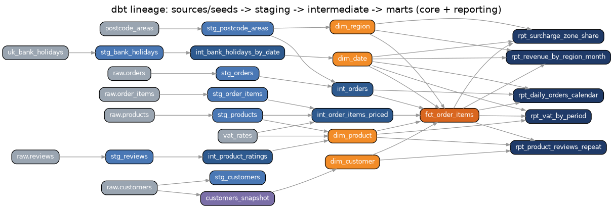
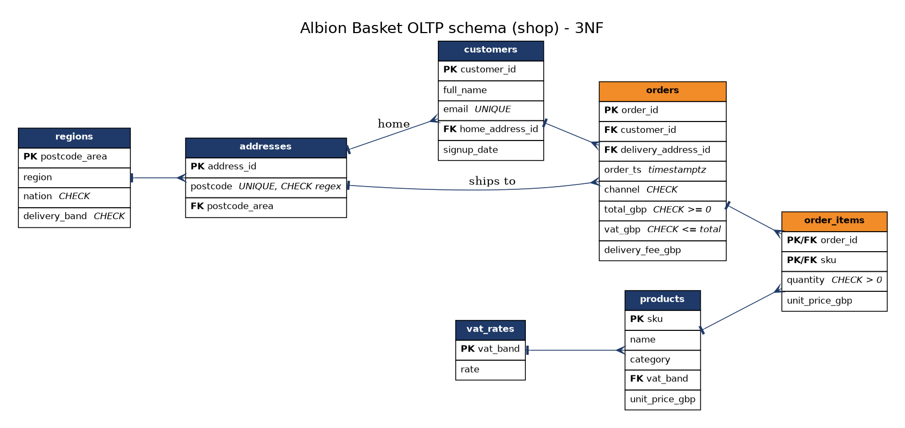

# UK Retail Data Platform: Albion Basket

A trusted data platform for **Albion Basket**, a (fictional) UK online grocery and homeware retailer.
Raw files → Python ingestion and UK business rules → PostgreSQL + MongoDB → pandas → a tested **dbt star schema**.



## Headline results

| # | Business question | Answer (from the warehouse) |
|---|---|---|
| 1 | Which regions drive revenue / grow fastest? | South East (12.6%) and London (11.5%) are biggest. **Scotland grew 51%** H1 2025 vs H1 2024; the South West shrank 7%. |
| 2 | Bank holidays, Black Friday, Christmas? | **Black Friday +134%** vs the 28-day average, Cyber Monday +94%, E&W bank holidays +22%, Christmas Day −74%. |
| 3 | Worst reviews and repeat purchase? | 5 well-reviewed-enough products average ~2★. Customers whose **first order** had one placed **4.7 orders vs 8.6** (−46%). |
| 4 | VAT per quarter / tax year? | **£143.0k in 2023/24, £159.2k in 2024/25** (+11%). Reconciles to the penny with line-level VAT. |
| 5 | Share to surcharge zones? | **6.8%** (3.5% Highlands & Islands, 3.2% Northern Ireland), rising from 5.5% to 7.8% of monthly orders. |

**The one number for leadership:** customers whose first basket contains one of five poorly rated products order 46% less. Fix or delist them.

---

## Repo layout

```
uk-retail-data-platform/
├── data/
│   ├── generate_data.py        synthetic raw data (seeded, reproducible)
│   ├── raw/                    generated files (git-ignored)
│   └── reference/              postcode areas → region/nation, GOV.UK bank holidays
├── ingestion/
│   ├── ingest.py               M1  types, structures, duplicates, summary
│   ├── rules.py                M2  UK business rules, postcodes.io retry loop
│   └── load_pg.py              M4  loads PostgreSQL in one transaction
├── sql/
│   ├── schema.sql              M4  3NF DDL with PK/FK/NOT NULL/CHECK
│   └── queries.sql             M3  15 commented business queries
├── mongo/
│   ├── mongo_load.py           M5  documents, validator, indexes
│   ├── pipelines.py            M5  aggregation pipelines
│   └── design_note.md          M5  documents vs tables
├── notebooks/
│   ├── analysis.ipynb          M6  joins both stores, 5 charts, findings, raw export
│   └── figures/
├── warehouse/                  M7  dbt project (staging → intermediate → marts)
├── tests/                      pytest for ingest + rules
├── scripts/                    run_all.sh, SCD2 demo, notebook builder, bank-holiday refresh
├── docs/                       ERD, lineage graph, demo script
├── .github/                    CI workflow + PR template
├── docker-compose.yml
├── .env.example
└── README.md
```

---

## Setup (once)

**You need:** Python 3.11+, Git, and Docker Desktop (or local PostgreSQL 14+ and MongoDB 6+).

```bash
git clone https://github.com/<you>/uk-retail-data-platform.git
cd uk-retail-data-platform
python -m venv .venv && source .venv/bin/activate      # Windows: .venv\Scripts\activate
pip install -r requirements.txt
cp .env.example .env                                    # then set PG_PASSWORD
docker compose up -d                                    # PostgreSQL on 5432, MongoDB on 27017
```

`.env` is git-ignored. dbt reads the same variables, so on Mac/Linux export them before running dbt:
`set -a; source .env; set +a` (PowerShell: `Get-Content .env | % { if ($_ -match '^(\w+)=(.*)$') { $env:($matches[1]) = $matches[2] } }`).

**Run everything in one go:** `bash scripts/run_all.sh`. Or go module by module below; that's how you should build it and how the PRs should land.

---

## Module by module

### M1 Python data types & structures → `ingestion/ingest.py`

```bash
python data/generate_data.py      # creates data/raw/*
python -m ingestion.ingest
```

Reads `orders.csv` / `customers.json` into **lists of dicts**; IDs → `int`, money → `Decimal` (2 d.p., strips `£`),
timestamps → `datetime` in **Europe/London** (naive strings are UK time, `...Z` strings are converted from UTC),
a **set** of seen IDs catches duplicates, a **dict** maps postcode area → region, VAT bands live in a dict.

Expected:
```
orders       read=  48241  clean=  48071  rejected=  20  duplicated= 150  [missing_id=10, bad_timestamp=10]
customers    read=   6020  clean=   6000  rejected=   0  duplicated=  20
```

### M2 Comparison operators & loops → `ingestion/rules.py`

```bash
python -m pytest -v              # 20 tests including the 10 sample orders
python -m ingestion.rules
```

The loop skips and logs bad rows with `continue` (bad postcode format, negative totals), assigns delivery bands with
`if / elif` (mainland, Highlands & Islands = IV/HS/KW/ZE, Northern Ireland = BT), flags orders **≥ £500**, gives free
delivery **from £40**, and retries postcodes.io in a `while` loop up to 3 times (a 404 is a real answer, so it isn't retried).

Edge cases tested: exactly £500 and £499.99, exactly £40 and £39.99, lowercase/no-space postcodes, KA (Arran) is *not*
a surcharge area, retry succeeds on the 3rd attempt, gives up after 3, no retry on 404.

> Note: the brief's slide snippet has `if o["total"] -= 500:`, which is a syntax error. The comparison is `>=`.

### M3 SQL fundamentals → `sql/queries.sql`

Run after M4 has loaded the tables (M3 needs data to query):
```bash
psql -h localhost -U postgres -d albion -f sql/queries.sql
```
15 commented queries: top products (`ORDER BY/LIMIT`), revenue by nation with `HAVING > £50,000`, region growth with
`FILTER`, monthly trend in UK time, delivery bands with `CASE WHEN`, VAT per quarter and per **6 April tax year**,
VAT by band, high-value orders, free-delivery share, top customers, repeat rate (`LEFT JOIN`), busiest days.

### M4 Data modelling, GitHub & database with Python → `sql/schema.sql`, `ingestion/load_pg.py`

```bash
python -m ingestion.load_pg
```



Design decisions worth saying out loud in review:
- **3NF:** VAT rate lives once in `vat_rates`; region/nation/delivery band depend only on `postcode_area`, so they live in `regions`.
- **`addresses` is its own entity**, so an order can ship somewhere other than the buyer's home (gifts) without duplicating data.
- `order_items.unit_price_gbp` is *not* redundant: it is the price **at the time of sale**.
- Derived values (`is_high_value`, region on an order) are in the view `shop.v_orders`, never stored, so they can't go stale.
- Constraints: `CHECK (total_gbp >= 0)`, `vat_gbp <= total_gbp`, postcode regex, `quantity > 0`, channel and band enums, unique email.
- The load is **one transaction**: it all lands or none does. Credentials only come from `.env`.

Expected: `shop.orders 48016 rows`, `shop.order_items 478470 rows` (738 lines dropped because their orders were rejected).

### M5 NoSQL with MongoDB → `mongo/`

```bash
python -m mongo.mongo_load
python -m mongo.pipelines
```
Reviews are documents with an embedded product snapshot, a `tags` array and a `$jsonSchema` validator (rating 1–5).
Indexes on `reviews.sku`, `reviews.customer_id`, `events.event_ts`, `events.(session_id, event_ts)`.
Pipelines: average rating per product (worst first), **basket abandonment by device** (mobile 63%, desktop 39%),
complaint tags via `$unwind`, rating by category. Read `mongo/design_note.md` for the documents-vs-tables reasoning.

### M6 SQL, Python, pandas & GitHub → `notebooks/analysis.ipynb`

```bash
jupyter lab notebooks/analysis.ipynb        # or run it headless:
jupyter nbconvert --to notebook --execute --inplace notebooks/analysis.ipynb
```
Pulls orders with `read_sql` and reviews from MongoDB, checks dtypes/nulls/duplicates, converts to Europe/London,
reconciles VAT (0 orders off by more than 1p), answers Q1–Q5 with **five charts** and written findings,
then exports curated tables to the `raw` schema (TRUNCATE + append, so re-runs don't break dbt's views).
The notebook is generated from `scripts/build_notebook.py`. Edit there, then rebuild, to keep git diffs readable.

### M7 dbt & data warehousing → `warehouse/`

```bash
cd warehouse
dbt debug          # checks the connection (profiles.yml in this folder reads env vars)
dbt seed           # postcode areas, bank holidays, VAT rates
dbt snapshot       # SCD2 history of customers
dbt build          # models + 71 tests  → PASS=96 WARN=0 ERROR=0
dbt docs generate && dbt docs serve     # browse docs and the lineage graph
```

| Layer | Models |
|---|---|
| staging (views) | `stg_orders`, `stg_order_items`, `stg_customers`, `stg_products`, `stg_reviews`, `stg_postcode_areas`, `stg_bank_holidays` |
| intermediate (views) | `int_orders`, `int_order_items_priced`, `int_bank_holidays_by_date`, `int_product_ratings` |
| marts/core (tables) | `fct_order_items` (grain: one row per product per order), `dim_date`, `dim_customer` (SCD2), `dim_product`, `dim_region` |
| marts/reporting | `rpt_revenue_by_region_month`, `rpt_daily_orders_calendar`, `rpt_product_reviews_repeat`, `rpt_vat_by_period`, `rpt_surcharge_zone_share` |

Tests: `unique`, `not_null`, `relationships` (every fact key → its dimension), `accepted_values`, plus singular tests:
VAT in the fact reconciles to every order, fact revenue equals order totals, one current SCD2 row per customer with
no overlapping windows, the 5/6 April tax-year boundary, and Black Friday dates.

**SCD Type 2 demo** (do this live in the presentation):
```bash
python scripts/apply_customer_moves.py     # 260 customers move house
cd warehouse && dbt snapshot && dbt build
```
```sql
select customer_id, version_number, postcode, region, valid_from, valid_to, is_current
from core.dim_customer where customer_id = 6 order by version_number;
-- v1 North West (closed), v2 West Midlands (current)
```
The first version's `valid_from` is back-dated to 1900-01-01 so orders placed before the first snapshot still join.

On Snowflake/BigQuery, swap `generate_series` in `dim_date.sql` for `dbt_utils.date_spine` and change the profile; everything else is portable.

---

## Git workflow

`main` is protected (GitHub → Settings → Branches → Add rule: *Require a pull request before merging*, *Require approvals: 1*, *Require status checks: ci*).

One branch per module, small commits, merged by reviewed PR:

```bash
git checkout main && git pull
git checkout -b feature/m1-ingest
git add data/generate_data.py data/reference ingestion/ingest.py tests/test_ingest.py
git commit -m "M1: ingest raw orders and customers with typed records and summary"
git push -u origin HEAD          # open the PR on GitHub, get a review, merge, delete the branch
```

| Branch | Files |
|---|---|
| `feature/m1-ingest` | `data/`, `ingestion/ingest.py`, `tests/test_ingest.py` |
| `feature/m2-rules` | `ingestion/rules.py`, `tests/test_rules.py` |
| `feature/m3-sql` | `sql/queries.sql` |
| `feature/m4-model` | `sql/schema.sql`, `ingestion/load_pg.py`, `docs/erd.*`, `.env.example` |
| `feature/m5-mongo` | `mongo/` |
| `feature/m6-analysis` | `notebooks/`, `scripts/build_notebook.py` |
| `feature/m7-dbt` | `warehouse/`, `scripts/apply_customer_moves.py`, `docs/lineage.*` |
| `chore/ci-readme` | `.github/`, `README.md`, `scripts/run_all.sh`, `docker-compose.yml` |

Good commit messages say *what and why*: `M2: retry postcodes.io up to 3 times; don't retry 404s`.
CI (`.github/workflows/ci.yml`) runs the tests, the whole pipeline and `dbt build` on every PR.

---

## 10-minute demo

See [`docs/demo_script.md`](docs/demo_script.md).

## Assumptions

- Data is synthetic and seeded (`SEED = 42`), so every number above is reproducible.
- Shelf prices are VAT-inclusive (UK consumer pricing): VAT = gross × rate / (1 + rate), rounded half-up per line.
- Generated postcodes are format-valid but mostly don't exist, so region comes from the postcode-area map;
  `rules.lookup_postcode` is there for enrichment of real postcodes and falls back cleanly when the API fails.
- Postcode areas that straddle regions are assigned to their dominant region.
- Bank holidays 2023–2025 are bundled; refresh from GOV.UK with `python scripts/fetch_bank_holidays.py`.
